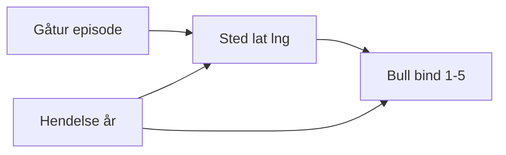

# Prosjektrapport: Oslo-historie

**Undertittel:** Romlig og tidsmessig formidling av *Kristianias historie* (Bull m.fl., 1922-1936)  
**Dokumenttype:** Utforskende praksisprosjekt / prosjektrapport med metoderefleksjon  
**Referansestil:** APA 7  
**Versjon:** 1.3, november 2025  
**HTML:** [prosjektrapport.html](prosjektrapport.html)  
**PDF:** [prosjektrapport.pdf](prosjektrapport.pdf)  
**Prosjektplan (visjon/slutt):** [PROSJEKTPLAN.md](PROSJEKTPLAN.md)  
**Forfatter:** Karina Sætersdal Nilssen  
**Prosjekttype:** Personlig lærings- og formidlingsprosjekt (ikke offisiell utgivelse fra forlag, museum eller kommune)  
**Arbeidsliste:** [FREMGANG.md](FREMGANG.md)

---

## Dedikasjon

Til Thomas, Alma og Celia - med takk for at dere deler byen med meg, og for at dere bærer hverdagen mens jeg går i Bulls spor.

---

## Sammendrag

Prosjektet *Oslo-historie* utvikler en statisk nettside (prototyp) som kobler Edvard Bulls fembindsverk *Kristianias historie* til konkrete geografiske steder i dagens Oslo. Løsningen består av et kart (Leaflet/OpenStreetMap) med posisjon og «trykk for historie», en kronologisk tidslinje og seks valgfrie gåtur-løyper. Innhold lagres strukturert i JSON med kildehenvisning (bind og sidetall). Historiske tekster er parafraserte sammendrag, ikke fulltekst. Kunstig intelligens (store språkmodeller via Cursor) brukes til utkast og strukturering underveis; endelig kildegjennomgang og sidetall skjer når rapporten ferdigstilles og prosjekteier går gjennom kildene (jf. prosjektplan). Prospectivt bidrar prosjektet til å gjøre et klassisk lokalhistorisk standardverk **brukbart i byrommet**, innenfor prinsipper for digital humaniora og opphavsrett.

**Nøkkelord:** lokalhistorie, digital formidling, Oslo, Edvard Bull, gåtur, kart, tidslinje, JSON, kvalitetssikring

---

## 1. Innledning

Norske byers historie er dokumentert i omfattende verk, men tilgang skjer ofte lineært på papir eller som fragmenterte oppslagsverk på nett. *Kristianias historie*, utgitt til byjubileet 1924, er et sentralt arbeid for forståelse av Oslo og Christiania fra middelalderen til 1920-årene. Verket er planlagt som kronologisk fortelling (Bull og Brøgger 1917), ikke som oppslagsbok - noe som gjør det særlig egnet til tematisk og tidssett sammenheng, men mindre egnet til rask lokalisering i dagens bylandskap.

Denne rapporten beskriver et praksisprosjekt som har til hensikt å **oversette Bulls periodisering og narrativ** til en geo-temporal brukeropplevelse: brukeren kan filtrere hendelser i tid, se dem på kart, og følge anbefalte gåtur-ruter. Rapporten dokumenterer problemforståelse, metode, verktøy, implementasjon, foreløpige resultater, begrensninger og videre arbeid.

---

## 2. Bakgrunn og problemstilling

### 2.1 Kildeverkets karakter

*Kristianias historie* utgis i forbindelse med Kristianias 300-årsjubileum i 1924 som **kronologisk fortelling** med vekt på utviklingslinjer og perioder - bevisst ikke som oppslagsverk (kommunale beretninger skulle dekke det). Utgivelsen var offentlig finansiert og regnes som moderne, kildedrevet byhistorie (jf. Ropeid 1970, via lokalhistoriewiki).

| Bind | Periode | Forfatter |
|------|---------|-----------|
| I | Oslos historie fram til 1624 | Edvard Bull |
| II | 1624-1740 | Edvard Bull |
| III | 1740-1814 | Bull / Valborg Sønstevold |
| IV | 1814-1877 | Simon Christian Hammer |
| V | 1878-1924 | Simon Christian Hammer |

Bøkene er rike, men vanskelige å bruke ute i byen uten kobling mellom avsnitt og sted. Prosjektet bygger bro mellom **bind på hylla** og **sko på asfalt**, med fysiske bind som første rettskilde for sidetall.

### 2.2 Problemet

Tre relaterte gap identifiseres:

1. **Geografisk gap:** Bøkene beskriver steder som fortsatt kan besøkes (Gamlebyen, Kvadraturen, Akerselva, slottskvartalet), uten systematisk GPS-basert kobling.  
2. **Formidlingsgap:** Mange digitale Oslo-tilbud er bredde (leksikon) eller dybde på én periode (f.eks. Oslo 1324, Oslo havn 1798), ikke én narrativ rød tråd gjennom hele standardverket.  
3. **Arbeidsflyt-gap:** Forfattere og lesere med kun papirutgaver mangler en strukturert måte å mate innhold til digitale hjelpemidler (her: AI-assistert) uten å digitalisere hele verk.

### 2.3 Overordnet problemstilling

*Hvordan kan et fembinds kronologisk byhistorisk verk kurateres og presenteres slik at det styrker romlig og tidsmessig forståelse for vandrende brukere - med sporbar kildehenvisning og uten å erstatte originalverket?*

### 2.4 Problem og løsning (oversikt)

| Problem | Løsning i prosjektet |
|---------|----------------------|
| Bøkene er lange og kronologiske, ikke geoknyttet | Kart med pins + utsnap av historie; valgfrie løyper med 4-7 stopp |
| Full digitalisering er juridisk og metodisk tung | Kun parafraser + `source_ref` (bind, sider) |
| Mange Oslo-apper er bredde (leksikon) eller ett tema (AR, 1324) | Én rød tråd: Bulls struktur bind for bind |
| AI kan hallusinere historie | Eier verifiserer ved levering; nettsiden viser «utkast» underveis |

### 2.5 Avgrensning: hva prosjektet er og ikke er

| Det er | Det er ikke |
|--------|-------------|
| Gåbare fortellinger med korte, parafraserte tekster | Ny vurdering eller erstatning for Bull/Hammer |
| Kildehenvisning til bind + sidetall | Fulltekst av verkene på nett |
| Én datamodell: sted, hendelse, løype, tag | Konkurrent til Oslo byleksikon (ca. 7000 artikler) |
| Læring, formidling og utforskning | Faglig autoritet uten redaktør |

---

## 3. Mål og delmål

| Mål | Indikator |
|-----|-----------|
| M1 Prototype med kart, tidslinje og gåtur | Fungerende `index.html` lokalt |
| M2 Kuratert innhold bind I-II (primært) | Minst 3 fullverdige løyper |
| M3 Kildehenvisning per tekstfelt | `source_ref` på places/events |
| M4 Kvalitetssystem | `verified`, utkast-badge i UI |
| M5 Reproduserbar prosess | Dokumentasjon, maler, FREMGANG |

Delmål M3-M5 adresserer metodisk troverdighet; M1-M2 adresserer brukernytte.

### 3.1 Målgruppe

1. **Leser av bindene** som vil forankre kapittler fysisk i byen.  
2. **Lokalhistorisk nysgjerrige** og Oslo-entusiaster som ønsker dybde fremfor mengde.  
3. **Fremtidig (valgfritt):** studenter, guider eller andre som trenger en Bull-indeksert byvandring.

Ikke primært rettet mot barn/familie-AR; målgruppen tåler et avsnitt per stopp og vil vite hvor i boken de kan lese videre.

---

## 4. Teoretisk og faglig rammeverk

Prosjektet plasseres i skjæringspunktet mellom:

- **Lokalhistorie** som disiplin (nærstudium av økonomisk og sosial utvikling; Bull som representant).  
- **Digital humaniora / spatial humanities:** knytte tekst til sted og tid (Prescott & Øwarn 2011-lignende tenkning; ikke empirisk testet her).  
- **Designorientert forskning:** prototype som artefekt for å utforske problemstilling (Wieringa 2014, forenklet).  
- **Kildekritikk** i tradisjonen etter Bull: primærkilde er trykt bind; digitale sammendrag er sekundær formidling.

Prosjektet hevder ikke å produsere ny historieforskning, men **ny formidlingsform** på eksisterende forskningsformidlet tekst.

---

## 5. Metode

### 5.1 Overordnet design

En **iterativ praksismetode** i fire løkker:

1. **Les og strukturer** - kapittelregister (TOC) fra fysiske bind.  
2. **Kuratér** - velg milepæler, steder og løyper (episoder).  
3. **Modeller** - skriv sammendrag til JSON; AI genererer utkast, menneske redigerer.  
4. **Valider** - feltgåtur, sidetall-sjekk, sett `verified: true`.

### 5.2 Datainnsamling og kilder

| Type | Rolle i prosjektet |
|------|-------------------|
| Fysiske bind I-V | Primær autoritet for sidetall og innhold |
| Wikimedia/Nettbiblioteket PDF | Hjelpekilde for oppslag og OCR |
| Sekundær (lokalhistoriewiki, SNL) | Kontekst, ikke erstatning for Bull |
| OpenStreetMap | Geografisk bakgrunn |

Innholdsfortegnelser lagres i `sources/toc/`. Full OCR forutsettes lokalt under `sources/ocr/` (gitignorert). Kun utdrag brukes i arbeid med modell.

### 5.3 Kuratering (innholdsdesign)

- **Makro:** bind = sesong / tidslinjebånd.  
- **Meso:** episode = gåtur 40-50 min, 6-7 stopp.  
- **Mikro:** place (koordinater) + event (år, tema-tags).

Koblingsregel: én hendelse kan peke på flere steder; én løype filtrerer både kart og tidslinje.

### 5.4 Kvalitetssikring

- Alle oppføringer starter med `verified: false`.  
- UI viser «Sidetall: utkast» når referanse ikke er bekreftet.  
- Ingen lengre sitater publiseres uten eksplisitt utdrag fra bruker eller lisensavklaring.

### 5.5 Dokumentasjon av fremdrift

Én arbeidsliste: `content/FREMGANG.md` (syv steg). Unngår parallelle sjekklister for å redusere kognitiv last på prosjekteier.

---

## 6. Verktøy og teknologi

### 6.1 Utviklings- og innholdsverktøy

| Verktøy | Bruk |
|---------|------|
| **Cursor** (IDE) | Kodescaffolding, innholdsutkast, prosjektdokumentasjon |
| **Store språkmodeller** (via Cursor Agent) | Parafraseutkast, koordinatforslag, struktur - **ikke** endelig fakta uten korrektur |
| **Git / filsystem** | Versjonering av JSON og dokumenter |
| Valgfritt: **Microsoft Lens / Adobe Scan** | Skanning av TOC fra bind |
| Valgfritt: **OCR** (Tesseract/ocrmypdf, ABBYY) | Tekstuttrekk fra PDF |

### 6.2 Prototype-stack (leveranse)

| Lag | Teknologi | Begrunnelse |
|-----|-----------|-------------|
| Presentasjon | HTML5, CSS3, vanilla JavaScript | Lav terskel, ingen build, lett å hoste statisk |
| Kart | Leaflet 1.9, OpenStreetMap-raster | Gratis, ingen API-nøkkel |
| Data | JSON-filer (`places`, `events`, `episodes`, `tags`, `bind-sources`) | Lesbart, redigerbart uten database |
| Lokal kjøring | `python -m http.server` | Kreves for `fetch()` av JSON (CORS) |
| Skjema | `data/schema.json` | Dokumenterer kontrakt for nye felt |

Ingen backend, ingen brukerkonto, ingen analyse av brukerdata (personvern: ikke relevant i prototype).

### 6.3 Ekstern avhengighet

- CDN: unpkg.com (Leaflet).  
- Nett: OSM fliser, lenker til Wikimedia og lokalhistoriewiki.

---

## 7. Design og implementasjon

### 7.1 Brukergrensesnitt og brukerreise

**Typisk økt (ute eller på skrivebord):**

1. Velg løype (kort eller filter).  
2. Start gåtur - kart og tidslinje filtreres.  
3. Les sammendrag; merk «Sidetall: utkast» om ennå ikke verifisert.  
4. Åpne faksimile-lenker i detaljpanelet ved behov.  
5. Neste stopp; evt. vis alle bind på tidslinjen.

**Komponenter:**

- **Header:** statistikk, lenker til dokumentasjon.  
- **Løypekort:** hurtigvalg av episode.  
- **Panel venstre:** filtrerbar tidslinje + detalj.  
- **Panel høyre:** kart med fargekodet bind.  
- **Gåturlinje:** forrige / neste stopp.

Responsivt oppsett: mobil viser panel under hverandre.

### 7.2 Datamodell (logisk)



- **Place** - hvor; sammendrag; `source_ref`; `verified`  
- **Event** - når; `place_ids`  
- **Episode** - `place_order` for gåtur  

Filer: `data/places.json`, `events.json`, `episodes.json`, `tags.json`. Implementasjon: `js/app.js`.

### 7.3 Mappestruktur

- `content/` - dokumentasjon (dette dokumentet, FREMGANG)  
- `data/` - runtime-innhold  
- `sources/` - TOC og evt. lokale PDF/OCR  
- `templates/` - JSON-maler for utvidelse  

---

## 8. Resultater (foreløpig, november 2025)

### 8.1 Nettside (prototyp)

Lokal nettside med synkronisert kart og tidslinje er implementert og testet med HTTP-server.

### 8.2 Innholdsmengde og løyper

| Enhet | Antall |
|-------|--------|
| Kartsteder (places) | 25 |
| Tidslinjehendelser (events) | 36 |
| Aktive gåtur-løyper | 5 |
| Planlagt løype | 1 (Mot 1924) |
| Tema-tags | 6 |

| id | Tittel | Stopp | Bind | Status innhold |
|----|--------|-------|------|----------------|
| 1624-ny-by | 1624 - nye Kristiania | 6 | I-II | på nettsiden; verifiseres |
| middelalder-oslo | Middelalder-Oslo | 7 | I | utkast |
| kvadraturen-1600 | Kvadraturen 1600-1700 | 6 | II | utkast |
| akerselva-tidlig | Akerselva tidlig industri | 6 | II-III | utkast |
| 1814-hovedstaden | 1814-hovedstaden | 4 | III-IV | utkast |
| mot-1924 | Mot 300-årsjubileet | 0 | IV-V | planlagt |

### 8.3 Dekning per bind (innhold)

- **Bind I-II:** tre løyper med full `place_order` (Middelalder-Oslo, 1624, Kvadraturen).  
- **Bind II-III:** Akerselva-løype (utkast).  
- **Bind III-IV:** 1814-løype (utkast).  
- **Bind IV-V:** ikke kartlagt ennå.

### 8.4 Kvalitetsstatus

Overveiende innhold er **utkast** med hensyn til sidetall (`verified: false`). Neste valideringsgate er innholdsfortegnelse fra fysiske bind (FREMGANG steg 1).

---

## 9. Diskusjon

### 9.1 Styrker

- Tydelig sporbarhet til Bull-verket (bind/side).  
- Lav teknisk kompleksitet senker vedlikehold.  
- Modellen skalerer kapittel for kapittel uten å kreve full digitalisering.  
- Skiller seg fra leksikon-bredden ved kuratert narrativ.

### 9.2 Plassering blandt andre Oslo-prosjekter

| Prosjekt | Styrke | Oslo-historie |
|----------|--------|----------------|
| [oslobykart.no](https://oslobykart.no/) | Bredde, oppslag | Smal Bull-kuratert narrativ |
| [Tidsløype](https://tidvis.no/tidsloype/) | AR, spill | Tekst + kart, ingen AR |
| [Oslo 1324](https://oslo1324.no/) | Immersiv middelalder | Hele tidslinjen 1000-1924 |
| [Oslo havn 1798](https://oslohavn1798.no/) | En periode, visualisering | Via bind I-V / bokverk |

Nisje: sporbarhet til bind - «står du her, les Bull bind II s. 35-60».

### 9.3 Begrensninger

1. **AI-genererte sammendrag** kan inneholde unøyaktigheter før menneskelig korrektur.  
2. **Sidetall** uten bruker-levert TOC forblir omtrentlige (~).  
3. **Hammer-bind** (IV-V) har annen tone enn Bull; samme UI skjuler ikke forfatterskifte fullt ut.  
4. **Statisk JSON** uten CMS gjør samarbeid tyngre enn database-løsning.  
5. **Ingen brukertesting** med eksterne deltakere er gjennomført ennå.

### 9.4 Etikk og opphavsrett

- Verket er fra 1920-tallet; **formidling** via korte sammendrag er forsvarlig; **republisering av fulltekst** krever nøye vurdering.  
- AI brukes som hjelpeverktøy; prosjekteier er ansvarlig redaktør.  
- Åpen kildekode til *struktur* kan deles; OCR av hele bøker holdes lokalt.

### 9.5 Validitet (forskningsmessig beskjedent)

Prosjektet er et **utforskende designartefakt**, ikke en hypotesetest med statistisk generalisering. «Validitet» vurderes fremover ut fra: korrekte sidetall, historikeres tilbakemelding, og brukeropplevelse på felt.

---

## 10. Konklusjon

*Oslo-historie* demonstrerer at et klassisk fembindsverk kan **restruktureres** til geo-temporal formidling med enkel webteknologi og en dokumentert kurateringsflyt. Prototype viser at kart, tidslinje og gåtur kan dele én datamodell, og at Kildehenvisning på nivå bind/side kan integreres i brukergrensesnittet. Foreløpig er den faglige kjernen ufullstendig verifisert; prosjektets metodiske bidrag ligger like mye i **arbeidsflyten** (TOC-først, kuratert JSON, AI-utkast, menneske verifiserer) som i selve nettsiden.

Prosjektet anbefales videreført med systematisk fullføring av FREMGANG steg 1-4 før utvidelse til bind V og evt. pilotering med eksterne brukere.

---

## 11. Videre arbeid

Sluttmål og faser: [PROSJEKTPLAN.md](PROSJEKTPLAN.md). Daglig rekkefølge: [FREMGANG.md](FREMGANG.md). Prioritert:

1. Innholdsfortegnelser inn fra alle bind.  
2. Verifisere løype 1624 og deretter øvrige løyper bind I-II.  
3. Feltgjennomgang av alle ruter.  
4. Utvide og kvalitetssikre bind III-V.  
5. Valgfritt: statisk hosting og brukertest.

---

## 12. Referanser

Referanselisten følger APA 7 (norsk). I teksten brukes forfatter-år. Nettkilder har hentedato.

Agafonkin, V. (n.d.). *Leaflet* [Dataprogram]. https://leafletjs.com/

Bull, E. (1922-1936). *Kristianias historie* (bd. 1-5). J. W. Cappelens forlag.

Bull, E., & Brøgger, A. W. (1917). Kristianias historie. *St. Hallvard*. https://lokalhistoriewiki.no/wiki/Kristianias_historie

Lokalhistoriewiki. (u.å.). *Kristianias historie*. Hentet 25. november 2025, fra https://lokalhistoriewiki.no/wiki/Kristianias_historie

OpenStreetMap contributors. (n.d.). OpenStreetMap [Kartdata]. https://www.openstreetmap.org/copyright

Ropeid, A. (1970). Byhistorie og byhistorisk forskning. I Knut Kjeldstadli (Red.), *Lokal historie i forskning og kulturarbeid gjennom 200 år* (s. 113-136). Universitetsforlaget.

Store norske leksikon. (u.å.). Edvard Bull (den eldre). I *Store norske leksikon*. https://snl.no/Edvard_Bull_-_den_eldre

Store norske leksikon. (u.å.). Oslo - historie. I *Store norske leksikon*. https://snl.no/Oslo_-_historie

---

## Vedlegg A: Forskningsmessig plassering (kort)

Dokumentet kan leveres som **praksisrapport** ved studier i digital formidling, lokalhistorie eller tilsvarende. APA-formatert HTML: `content/prosjektrapport.html`. Visjon og sluttleveranse: `content/prosjektplan.html`.

---

## Vedlegg B: Tekster for presentasjon (kopierbar)

### Elevator pitch (2 setninger)

Oslo-historie kobler Edvard Bulls fembindsverk om byen til gåbare ruter og et kart i mobilen. Du leser korte, kildehenviste sammendrag ute på stedet - og kan slå opp bind og sidetall når du vil dykke dypere i bøkene.

### Kort (ca. 280 tegn)

Prosjekt som gjør *Kristianias historie* (Bull, 1922-1936) gåbar: kart, tidslinje og 40-min løyper fra middelalder-Oslo til 1814. Ikke leksikon - kuratert narrativ med sidetall. Prototype lokalt; innhold verifiseres mot bøkene.

### Tittelforslag

**Bulls by: gå Kristianias historie i Oslo** - *Kart, tidslinje og gåtur med kildehenvisning til bind I-V.*

---

## Vedlegg C: Verktøyliste (kopierbar)

```
Cursor IDE + Agent (innhold/kode)
Python 3 (http.server)
Leaflet + OpenStreetMap
JSON-editor / VS Code / Cursor
Valgfritt: Microsoft Lens, ocrmypdf, Tesseract (nor)
Primærkilde: fysiske bind Kristianias historie
```

---

*Ende av prosjektrapport v1.3 (APA 7)*